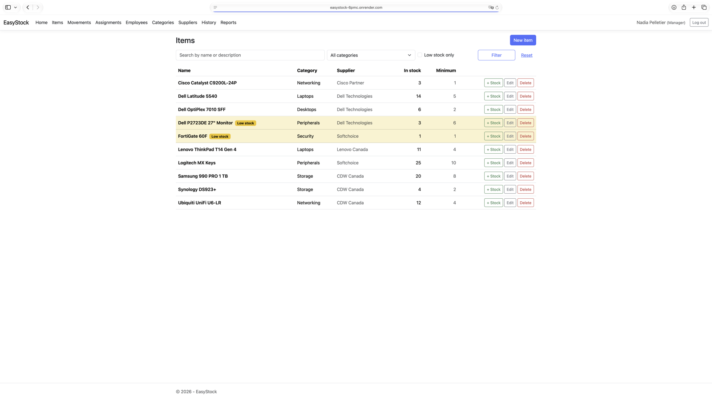
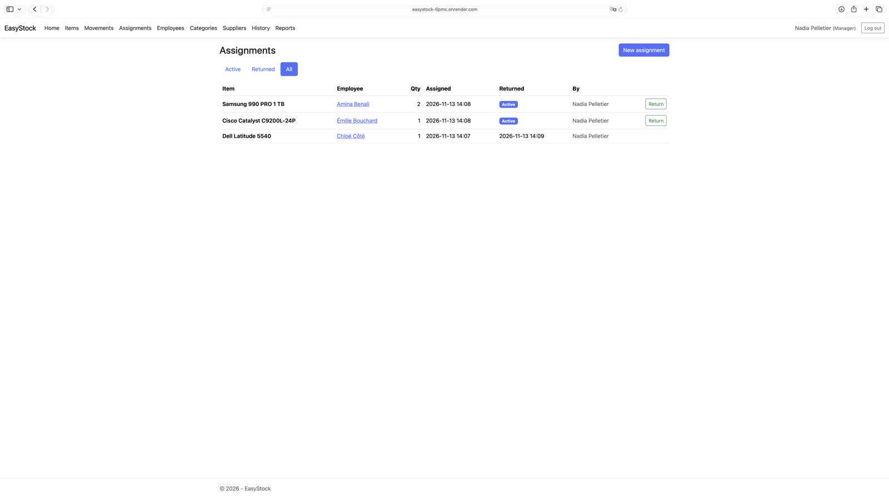
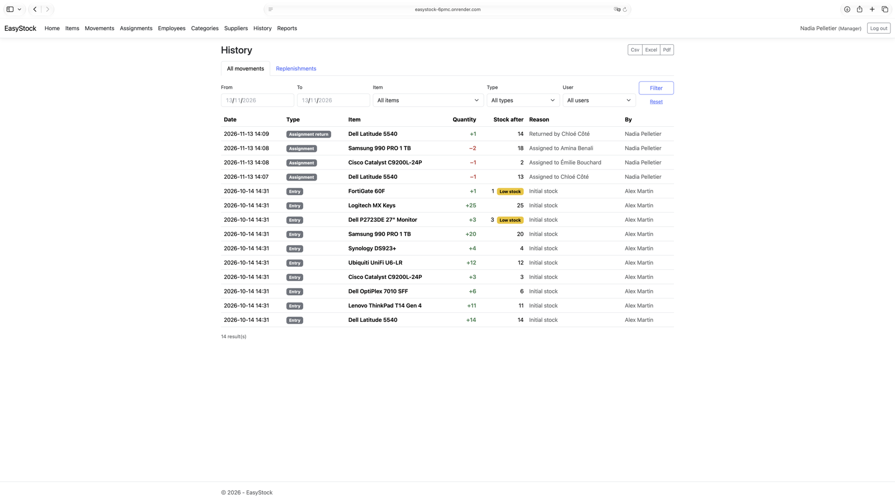
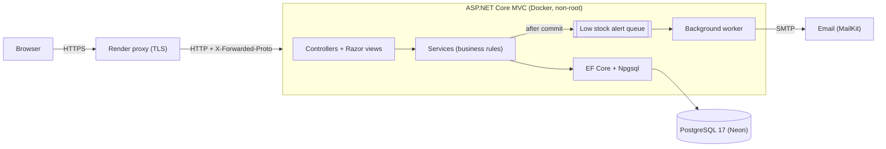
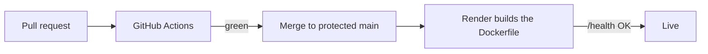

# EasyStock

[](https://github.com/yacinegadouche/easystock/actions/workflows/ci.yml)

**Live demo:** https://easystock-6pmc.onrender.com
Sign in as `manager` or `operator` with the password `Demo123!`.
The demo runs on a free tier and sleeps when idle: the first visit can take about a minute to wake up.

IT asset and inventory management web application built with **ASP.NET Core MVC (.NET 10)** and **PostgreSQL**: equipment, suppliers, employees, assignments, stock movements, history, reports and low stock alerts.

> Re-implementation of the EasyStock team project from the INM5151 course (Software Engineering Project) at UQAM, rebuilt from scratch with PostgreSQL instead of SQL Server.



## Features

- **Inventory**: items, categories and suppliers, with search and filters
- **Assignments**: lend equipment to employees and record returns, with full history per employee
- **Stock movements**: entries, exits and returns, recorded in an immutable ledger
- **Low stock alerts**: visual badges and email notifications when an item reaches its minimum
- **History**: every movement filtered by date range, item, type and user, plus a replenishment history
- **Reports**: inventory, low stock, movements and replenishments exported as **CSV, Excel or PDF**
- **Roles**: Admin (everything, including users), Manager (inventory, history, reports), Operator (inventory)

| Assignments | History |
|---|---|
|  |  |

## Architecture



A single web project, organized by responsibility: thin controllers, services holding the business rules, view models for every form and page, and EF Core for data access.

## Technical highlights

**Data integrity**
- Stock is changed with a single conditional `UPDATE` (`ExecuteUpdateAsync`), so two users can never assign the last unit at the same time. A test runs two concurrent assignments against a real PostgreSQL to prove it.
- Every stock change is written to an immutable movement ledger, inside a transaction shared with the assignment that caused it.
- Database constraints back up the business rules: non-negative stock, unique names, restricted deletes.

**Security**
- Cookie authentication with PBKDF2 password hashing, secure-by-default authorization (every page requires sign-in unless explicitly public) and role-based policies.
- CSRF tokens on every form, open-redirect protection on sign-in, and sessions revalidated so deactivated users or role changes take effect.
- CSV exports protected against formula injection, user content HTML-encoded in emails, and no secret stored in the repository.

**PostgreSQL and time zones**
- snake_case naming, UTC `timestamptz` storage, displayed in Montréal time with daylight-saving-aware date filters.

**Reliability**
- Low stock emails are queued after commit and sent by a background worker: an SMTP outage never blocks or rolls back a stock movement.
- Health checks, data protection keys stored in PostgreSQL (sign-ins survive restarts), and migrations applied on startup when enabled.

## Tech stack

| Area | Technologies |
|---|---|
| Backend | ASP.NET Core MVC (.NET 10), C# |
| Data | Entity Framework Core, PostgreSQL 17 (Npgsql) |
| Front end | Razor views, Bootstrap 5 |
| Reports | ClosedXML (Excel), QuestPDF (PDF) |
| Email | MailKit, Mailpit for local testing |
| Tests | xUnit, Testcontainers |
| DevOps | Docker, GitHub Actions, Dependabot, Render, Neon |

## Getting started

### Prerequisites

- .NET 10 SDK
- Docker Desktop

### Run locally

```bash
cp .env.example .env            # then set POSTGRES_PASSWORD and DEMO_PASSWORD
docker compose up -d
dotnet user-secrets set "ConnectionStrings:DefaultConnection" \
  "Host=localhost;Port=5432;Database=easystock;Username=easystock;Password=<your-password>" \
  --project src/EasyStock.Web
dotnet user-secrets set "Seed:DemoPassword" '<choose-a-password>' --project src/EasyStock.Web
dotnet run --project src/EasyStock.Web
```

Migrations and demo data are applied automatically in development. Health check: `GET /health`.

### Demo accounts

| Username | Role | Access |
|---|---|---|
| `admin` | Admin | Everything, including user management |
| `manager` | Manager | Inventory, history and reports |
| `operator` | Operator | Inventory only |

All demo accounts use the password set in `Seed:DemoPassword`.

### Emails in development

`docker compose up -d` also starts [Mailpit](https://mailpit.axllent.org), a local SMTP server that catches every email. Low stock alerts are visible at http://localhost:8025.

### Run the whole stack with Docker

```bash
docker compose --profile app up -d --build
```

The app runs at http://localhost:8080 in the `Production` environment.

## Tests

```bash
dotnet test
```

Docker must be running: integration tests start a disposable PostgreSQL 17 container with [Testcontainers](https://dotnet.testcontainers.org), and each test gets its own fresh database.

- **Unit tests**: domain rules, CSV export (escaping, BOM, formula injection), time zone conversion
- **Integration tests**: stock movements, assignments (transaction rollback, concurrent assignment of the last unit), authentication, user and category rules
- **Web tests**: anonymous redirect to sign-in, public health endpoint

## CI/CD



Every pull request checks formatting, builds with warnings as errors, runs all tests on Linux with PostgreSQL, and runs unit tests on Windows and macOS. `main` only accepts pull requests with a green CI, and every merge is deployed automatically.

## Project structure

```
src/EasyStock.Web/
├── Controllers/      HTTP endpoints
├── Services/         business rules and data access
├── Models/           domain entities
├── ViewModels/       forms and page models
├── Data/             DbContext, Fluent API configurations, migrations, seed data
├── Reports/          CSV, Excel and PDF exporters
├── Notifications/    low stock alerts and email sending
├── Authorization/    policies and cookie validation
└── Views/            Razor views
tests/EasyStock.Tests/
├── Unit/
├── Integration/
└── Web/
```

## Known limitations

- Low stock alerts are queued in memory: an alert can be lost if the app restarts before sending it. The Outbox pattern would make delivery guaranteed.
- The supplier shown in the replenishment history is the item's current supplier, not the one recorded at the time of the entry.
- Items with stock history cannot be deleted; an archive feature would be the natural next step.

## License

[MIT](LICENSE)